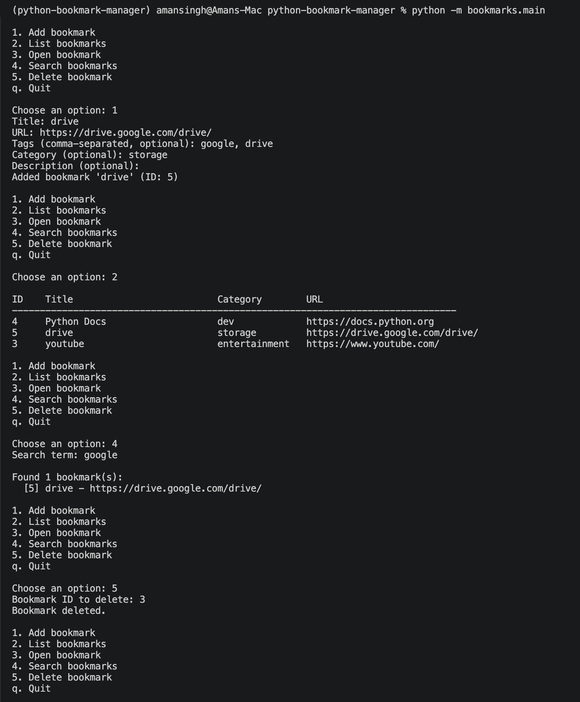
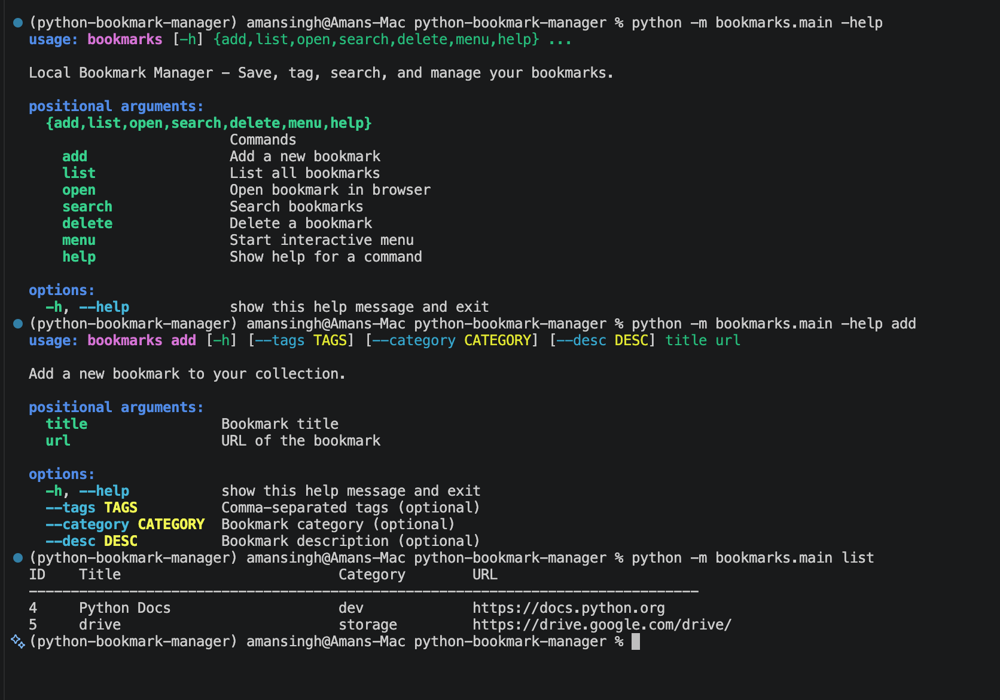

# Local Bookmark Manager

A command-line tool to save, tag, search, and open bookmarks.  
Built with **only the Python standard library** (uses `webbrowser` to open links).

## Features

- Add, list, search, open, and delete bookmarks
- Tags and categories
- Opens links in your default browser
- Interactive menu + direct commands
- Uses pure standard library

## Demo
### 1. Interactive simulation (CLI)



### 2. Direct via commands simulation (CLI)


## Project Structure

```
bookmark-manager/
├── src/
│   └── bookmarks/
│       ├── __init__.py
│       ├── main.py
│       ├── config.py
│       ├── models.py
│       ├── database.py
│       └── services/
│           └── bookmark_service.py
├── data/          # SQLite database created here
├── tests/
├── pyproject.toml
├── README.md
└── .gitignore
```

## Requirements

- Python 3.12 or higher (recommended: 3.15)
- No external packages

## Setup (Recommended: Virtual Environment)

**Recommended tool: [uv](https://docs.astral.sh/uv/)** (fast, modern, industry-grade).

```bash
curl -LsSf https://astral.sh/uv/install.sh | sh
uv venv --python 3.15
source .venv/bin/activate          # Linux / macOS
# .venv\Scripts\activate           # Windows
uv pip install -e .                # optional
```

Other options: `python -m venv .venv`, Poetry, or conda.

## How to Run

Two ways of working:

1. **Interactive menu** 
   ```bash
   python -m bookmarks.main
   ```
   or
   ```bash
   python -m bookmarks.main menu
   ```

2. **Direct commands**

   ```bash
   # Show general help and list all commands
   python -m bookmarks.main help
   # or: python -m bookmarks.main --help

   # Get help for a specific command
   python -m bookmarks.main help add
   # or: python -m bookmarks.main -help add
   # or: python -m bookmarks.main add --help

   python -m bookmarks.main help delete
   # or: python -m bookmarks.main -help delete
   ```

### Examples

```bash
# Add a bookmark
python -m bookmarks.main add "Python Docs" "https://docs.python.org" --tags "python,docs" --category "dev"

# List all bookmarks
python -m bookmarks.main list

# Open a bookmark in browser
python -m bookmarks.main open 1

# Search
python -m bookmarks.main search python

# Delete
python -m bookmarks.main delete 1
```

## Running Tests

Run the full test suite using Python's built-in `unittest`:

```bash
# Run all tests
python -m unittest discover -s tests
```

> **Note:** If you haven't installed the package in editable mode (`pip install -e .`), prefix with `PYTHONPATH=src`:
> ```bash
> PYTHONPATH=src python -m unittest discover -s tests
> ```

You can also run individual test files:

```bash
# Core logic & database tests
python -m unittest tests/test_bookmarks.py

# CLI arguments & help command tests
python -m unittest tests/test_cli.py
```

## License

Educational use only.
